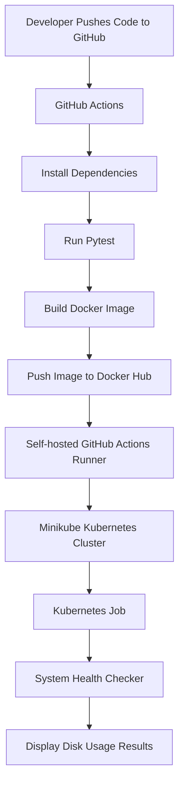

# Py_devops – Automated System Health Checker

A Python-based system health monitoring application that checks disk utilization and reports system storage information. The project demonstrates an automated CI/CD pipeline using GitHub Actions, Docker, Docker Hub, and Kubernetes.

## Project Overview

Py_devops is a containerized system health checker that collects disk usage information and identifies critically high disk utilization.

The application is packaged using Docker and automatically deployed to a Kubernetes cluster through a GitHub Actions CI/CD pipeline.

## Architecture



## Technologies Used

- Python 3.12
- Pytest
- Docker
- Docker Hub
- Kubernetes
- Minikube
- GitHub Actions
- Linux / WSL Ubuntu

## Application Features

- Checks total disk capacity.
- Reports used and available disk space.
- Calculates disk utilization percentage.
- Displays a warning when disk usage reaches 90%.
- Records application activity using Python logging.
- Includes automated unit tests using Pytest.

## Project Structure

```text
Py_devops/
├── .github/
│   └── workflows/
│       └── ci.yml
├── app/
│   ├── __init__.py
│   └── main.py
├── tests/
│   └── test_main.py
├── k8s/
│   └── job.yaml
├── logs/
├── Dockerfile
├── requirements.txt
└── README.md
```

## CI/CD Pipeline

The GitHub Actions workflow automates the following stages:

1. Checks out the source code.
2. Sets up Python 3.12.
3. Installs project dependencies.
4. Executes automated tests using Pytest.
5. Builds the Docker image.
6. Authenticates with Docker Hub using GitHub Secrets.
7. Pushes the Docker image to Docker Hub.
8. Uses a self-hosted runner to connect to Minikube.
9. Deploys the Kubernetes Job.
10. Waits for job completion and displays application logs.

### Docker Hub Image

`suriyadeepan22/py-devops:latest`

The pipeline also publishes a commit-specific image tag.

## Kubernetes Deployment

The application runs as a Kubernetes Job rather than a continuously running service.

Deployment manifest: `k8s/job.yaml`

The Job executes the Python system health checker and completes after collecting disk utilization information.

### Verify Deployment

```bash
kubectl get nodes
kubectl get jobs
kubectl get pods
```

### View Application Output

```bash
kubectl logs job/disk-health-check
```

## Sample Output

```text
=== Py_devops System Health Checker ===
Disk path: /
Total space: 1006.85 GB
Used space: 21.51 GB
Free space: 934.13 GB
Disk usage: 2.14%
Disk status: OK
```

Actual disk values depend on the environment where the container runs.

## Run Locally

Clone the repository:

```bash
git clone https://github.com/suriyadeepan33/Py-devops.git
cd Py-devops
```

Run the application:

```bash
python -m app.main
```

Run automated tests:

```bash
python -m pytest -v
```

## Run with Docker

Build the image:

```bash
docker build -t py-devops .
```

Run the container:

```bash
docker run --rm py-devops
```

## GitHub Actions Configuration

Configure the following repository secrets for Docker Hub authentication:

- `DOCKERHUB_USERNAME`
- `DOCKERHUB_TOKEN`

The deployment job also requires an online self-hosted GitHub Actions runner with access to the Minikube Kubernetes cluster.

## Project Objective

This project demonstrates practical experience with Python automation, Linux system administration, automated testing, Docker containerization, CI/CD pipelines, container image management, and Kubernetes workload deployment.

## Author

**Suriya Deepan**

GitHub: https://github.com/suriyadeepan33

Project Repository: https://github.com/suriyadeepan33/Py-devops
